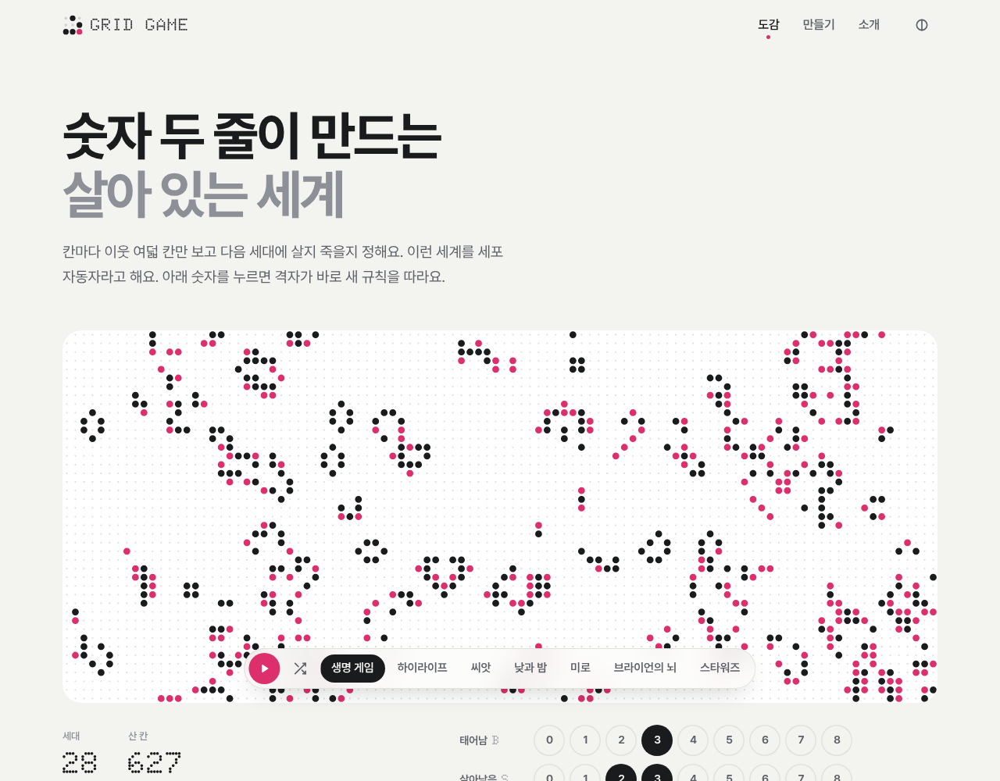
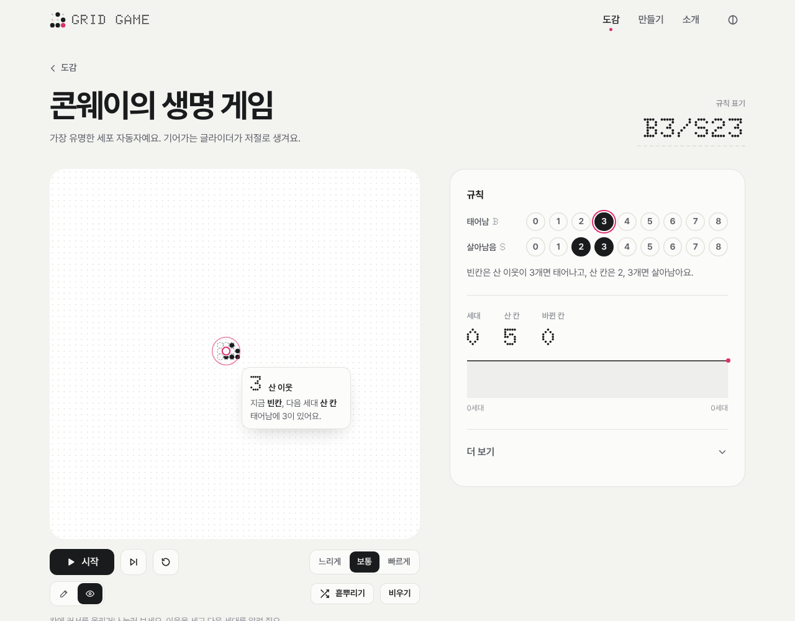

<h1 align="center">Grid Game</h1>

<p align="center">
  세포 자동자를 돌려 보고 규칙을 직접 만드는 곳<br>
  <a href="https://archi142857.github.io/grid-game/"><b>웹에서 바로 하기</b></a>
</p>

<p align="center">
  
</p>

콘웨이의 생명 게임 같은 세포 자동자를 브라우저에서 바로 돌려 보고, 규칙을 직접 바꿔 볼 수 있는 웹 앱입니다. 격자는 끝없이 이어져서 끌어서 둘러보고 휠로 키우고 줄일 수 있습니다. 처음 온 사람은 숫자 점 몇 개를 눌러 보는 것만으로 충분하고, 세포 자동자를 아는 사람은 B3/S23 같은 표기를 바로 고쳐 쓰거나 규칙 파일(JSON)을 내려받아 고칠 수 있습니다.

## 쓰는 법

1. 첫 화면에서는 생명 게임이 이미 돌아가고 있습니다. 격자 위의 이름 단추로 다른 규칙을 고르고, 격자를 끌어 둘러봅니다. 확대·축소는 오른쪽 위 단추나 Ctrl(⌘)+휠로 합니다.
2. 직접 시작 모습을 만들려면 `비우기`를 누르고 살릴 칸을 하나씩 누른 뒤 `재생`을 누릅니다. `일시정지`로 멈추고, `한 세대`로 한 걸음씩 넘기고, `처음으로`를 누르면 만든 모습으로 돌아옵니다.
   격자 오른쪽 위 맨 끝 단추(또는 `F`)를 누르면 격자가 화면을 가득 채우고, 재생 막대는 화면 아래 띠로 붙습니다. 다시 누르거나 `Esc`로 돌아옵니다.
3. `태어남`·`살아남음` 줄의 숫자 점을 누르면 규칙이 바로 바뀝니다. 숫자는 둘레 8칸 가운데 산 칸의 수입니다.
4. 도감에서 규칙을 고르면 규칙 화면으로 갑니다. 격자가 더 크고, 휠로 바로 확대·축소합니다. 아래의 손을 `그리기`로 바꾸면 끌어서 여러 칸을 한 번에 그리고, `살펴보기`로 바꾸면 칸의 산 이웃 수와 다음 세대의 모습, 그 까닭이 뜨고 까닭이 된 숫자 점에 테가 생깁니다.
5. `볼 것`의 `놓아 보기`는 글라이더 같은 이름난 무늬를 보는 곳 가운데에 놓고, `써 보기`는 비슷한 규칙으로 바꿉니다. 상태 수와 규칙 파일 내려받기·불러오기는 `더 보기` 안에 있습니다.

<p align="center">
  
</p>

## 지금 있는 규칙

| 규칙 | 표기 | 볼 것 |
| --- | --- | --- |
| 콘웨이의 생명 게임 | B3/S23 | 글라이더, 고스퍼 글라이더 총, R-펜토미노 |
| 하이라이프 | B36/S23 | 12세대마다 자기를 복제하는 복제자 |
| 씨앗 | B2/S | 산 칸은 한 세대만 사는데도 폭발하듯 퍼진다 |
| 낮과 밤 | B3678/S34678 | 산 칸과 빈칸을 뒤바꿔도 똑같이 움직인다 |
| 미로 | B3/S12345 | 가운데에서 미로가 자라 나간다 |
| 브라이언의 뇌 | B2/S/C3 | 꺼지는 칸이 꼬리를 남기며 날아다닌다 |
| 스타워즈 | B2/S345/C4 | 버티는 칸과 사라지는 칸이 어울려 부딪힌다 |

랭턴의 개미, 와이어월드, 1차원 규칙(규칙 30)은 규칙 파일만 먼저 만들어 두었고 다음 단계에서 돌립니다.

## 화면

- 칸은 점입니다. 격자, 규칙 숫자 단추, 로고, 도감 그림이 모두 같은 점으로 그려집니다.
- 색은 변화에만 씁니다. 바탕은 종이색과 흑연색이고, 방금 태어난 칸만 분홍 점으로 빛납니다. 사라지는 칸은 점이 작아지며 흐려집니다.
- 세대가 바뀔 때 점이 자라고 줄어들며 이어집니다. 빠르게 돌리거나 기기에서 '동작 줄이기'를 켜면 이어 그리지 않습니다.
- 글꼴은 두 가지입니다. 사람의 말은 Pretendard, 세대 수나 B3/S23 같은 기계의 숫자는 점으로 된 Doto 입니다.
- 밝은 화면과 어두운 화면을 모두 지원하고, 휴대폰에서도 같은 기능을 씁니다.

## 계산은 이렇게 합니다

- 칸 상태는 0(빈칸), 1(산 칸), 2 이상(사라지는 칸)입니다. 다음 상태는 지금 상태와 둘레 8칸(무어 이웃) 가운데 산 칸의 수로만 정해지므로, (상태, 이웃 수) → 다음 상태 표를 한 번 만들어 두고 칸마다 표만 찾습니다.
- 격자는 끝이 없습니다. 판을 32×32 조각으로 나누고 칸이 있는 조각만 `Map`에 둡니다. 조각마다 둘레 한 줄을 이웃 조각에서 빌려 와 한 세대를 넘기고, 가장자리에 산 칸이 닿은 조각은 그쪽에 빈 조각을 미리 만들어 둡니다(`js/core/plane.js`). 빈 조각은 한 세대 뒤에 치웁니다.
- 조각마다 Uint8Array 두 장을 번갈아 씁니다. 바로 앞 세대가 남아 있어서, 화면은 두 세대를 견주어 태어난 칸과 죽은 칸을 구별해 그립니다.
- 무늬가 조각 1024개(약 100만 칸) 넓이로 퍼지면 멈춥니다. 태어남 0 은 빈 곳 전체가 한꺼번에 태어나 버려서 쓸 수 없습니다.
- 화면은 칸 한 변을 늘 정수 픽셀로 두어 점이 흐려지지 않습니다. 칸이 작아지면 둥근 점 → 네모 → 픽셀 순으로 바꿔 그립니다.
- 무작위 시작 상태는 씨앗 번호가 같으면 언제나 같습니다(mulberry32). 도감 그림은 규칙마다 정해진 씨앗을 써서 늘 같은 모습입니다. 도감 그림만은 작은 판의 맞은편을 이어 붙여(토러스) 늘 판이 꽉 차게 돌립니다.
- 표기는 B3/S23 꼴 말고도 S23/B3, Golly·MCell 의 옛 꼴(23/3, /2/3, 345/2/4)을 읽습니다.
- 고친 규칙은 주소에 남습니다(`#/r/conway-life?rule=B36%2FS23`). 그 주소를 그대로 보내면 같은 규칙이 열립니다.

## 규칙 파일

도감 규칙, 직접 고친 규칙, 내려받은 파일이 모두 같은 JSON 꼴을 씁니다.

```json
{
  "id": "brians-brain",
  "name": "브라이언의 뇌",
  "description": "켜진 칸은 한 세대 동안 꺼지는 중이었다가 꺼져요. …",
  "family": "life",
  "grid": { "edges": "infinite" },
  "neighborhood": "moore",
  "states": [{ "name": "꺼짐" }, { "name": "켜짐" }, { "name": "꺼지는 중" }],
  "rule": { "birth": [2], "survive": [] },
  "seed": { "type": "random", "density": 0.2 }
}
```

- `states`: 순서가 곧 상태 번호입니다. `color`(#rrggbb)를 넣으면 그 색으로, 빼면 화면 색으로 그립니다. 3개 이상이면 Generations 규칙이 됩니다.
- `grid`: `edges`가 `infinite`면 끝없는 격자입니다(빼도 같습니다). Life 계열은 끝없는 격자에서만 돌립니다. `wrap`(이어 붙이기)·`wall`(벽)과 `width`·`height`는 다음 단계의 규칙(랭턴의 개미, 와이어월드)을 위한 자리입니다.
- `rule.birth`에는 0을 넣을 수 없습니다.
- `seed`: `empty`, `random`(`density`, 가운데만 채우려면 `area`), `single`(가운데 한 칸), `rle`(`data`에 RLE 무늬). 무작위로 뿌릴 때는 화면에 보이는 넓이를 기준으로 합니다.

## 직접 돌려 보기

```
python -m http.server 8000 -d web    # http://localhost:8000 에서 웹 앱
node --test                          # 테스트 (Node 20 이상)
```

빌드 단계가 없습니다. `web/` 폴더가 그대로 웹 앱이고, 브라우저가 ES 모듈을 바로 불러옵니다. `index.html`을 더블클릭해서 열면 모듈을 불러오지 못하니 위처럼 간단한 서버로 엽니다.

<details>
<summary>폴더 구조</summary>

```
web/                          웹 앱 (GitHub Pages)
  index.html, style.css
  icons/                      파비콘
  data/rules/                 규칙 파일. index.json 이 도감에 내놓는 목록이다
  data/patterns/              기본 무늬(RLE) 자리
  js/app.js                   화면 이동(#/, #/r/<id>, #/make, #/about)과 밝기
  js/core/                    계산: 끝없는 격자(plane), Life 계열 규칙(life), 작은 격자(grid), RLE, 난수(rng),
                              규칙 파일 검사(rules), 조사(josa)
  js/data/                    도감 글(catalog), 규칙 파일 불러오기(presets)
  js/ui/                      화면 조각: 점 격자와 보는 곳(board), 끌기·누르기·확대(nav), 세대와 기록(world),
                              돌리기(loop), 선 잇기(pen), 규칙 점 단추(rulepad), 재생 막대·확대 단추(widgets),
                              작은 그래프(spark), 도감 그림(thumb), 무늬 그림(art), 밝기(theme)
  js/views/                   화면: 첫 화면(home), 규칙·만들기(rule), 소개(about)
  js/i18n.js, js/i18n/        화면 글. 영어판은 i18n/en.js 를 채우면 된다
tests/                        node --test (끝없는 격자, 엔진, 작은 격자·RLE, 규칙 파일, 화면 글)
scripts/stamp.py              배포할 때 스크립트·스타일 주소에 판(?v=)을 붙인다
docs/screenshots/             이 README 의 화면 캡처
.github/workflows/pages.yml   테스트하고 GitHub Pages 로 올린다
```

</details>

## 고칠 때 알아 둘 것

- 도감 규칙을 더하려면 `web/data/rules/`에 규칙 파일을 넣고 `index.json`에 id 를 더한 뒤, `js/data/catalog.js`에 소개 글을 씁니다. 파일은 맨 위 항목마다 한 줄씩 적는 꼴(`formatRuleFile`)을 따르고, 테스트가 둘 다 확인합니다.
- 계산(`js/core/`)은 DOM 없이 돌아서 `node --test`로 시험합니다.
- 화면 글은 `t("한국어 틀")`로 감쌉니다. 숫자 뒤 조사는 `{n:이가}`처럼 적으면 받침에 맞춰 붙습니다.
- 색은 `style.css` 맨 위 변수만 씁니다. 신호색(`--signal`)은 방금 태어난 칸과 살펴보는 칸처럼 '변화'를 가리킬 때와 재생 단추에만 씁니다.
- 고급 설정은 화면에 늘어놓지 않고 `더 보기` 안에 둡니다.
- `main`에 푸시하면 Actions 가 테스트를 돌리고 `web/`을 GitHub Pages 로 올립니다. 처음 한 번은 레포 Settings → Pages → Source 를 `GitHub Actions`로 바꿔야 합니다.

## 라이선스

`LICENSE`(MIT)는 이 저장소의 **코드에만** 걸립니다.

| 무엇 | 조건 |
| --- | --- |
| 코드: `web/`, `scripts/`, `tests/` | MIT (`LICENSE`) |
| 글꼴: Pretendard, Doto. 저장소에 없고 jsDelivr 에서 불러옵니다 | SIL Open Font License 1.1 |
| 규칙 | 생명 게임은 존 콘웨이, 하이라이프와 낮과 밤은 네이선 톰프슨, 씨앗과 브라이언의 뇌는 브라이언 실버먼, 스타워즈는 미렉 보이토비치가 만들었습니다. 설명은 이 앱에서 새로 썼습니다 |
| 이름 `Grid Game`, 아이콘(`web/icons/`), 화면 캡처(`docs/screenshots/`) | 라이선스를 주지 않습니다(MIT 대상이 아닙니다) |

## 만든 사람

동물생명공학전공 25학번 이영표 · sanger.lee138@gmail.com

버그 제보와 새 규칙 제안은 [GitHub 이슈](https://github.com/Archi142857/grid-game/issues)에 남겨 주세요.
